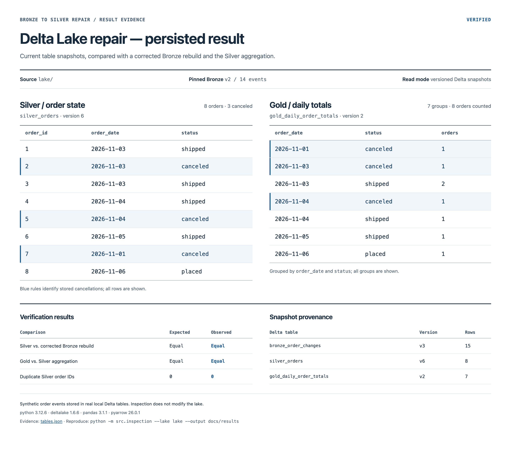
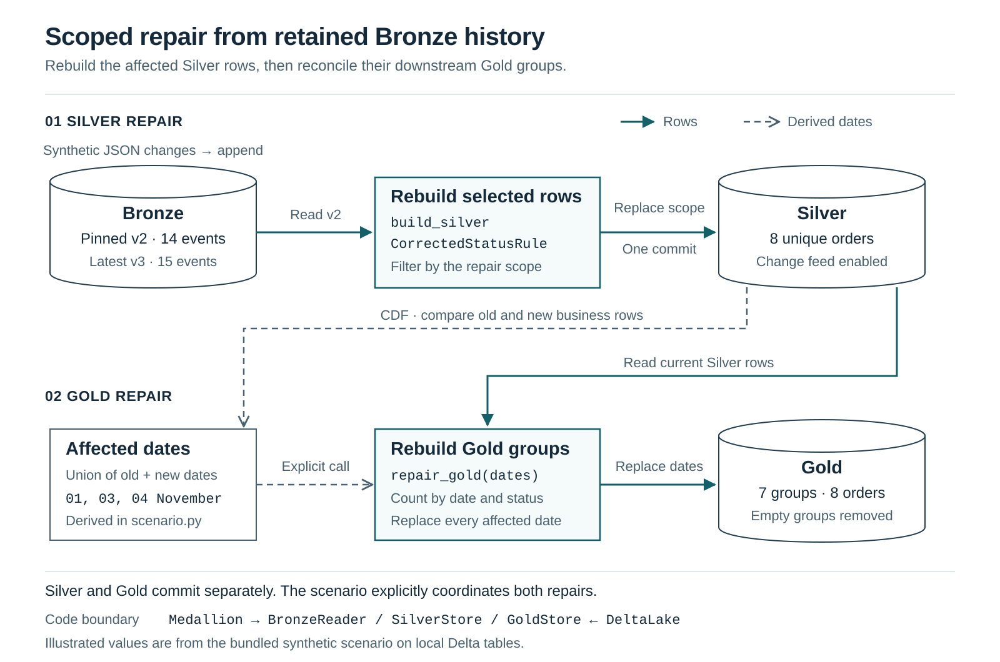

# Bronze to Silver Repair

**Repair incorrect Silver data from retained Bronze history, without reloading the source.**

An executable Delta Lake example of a scoped data repair, its downstream Gold correction, and the checks needed to prove the result. Companion code for **Can You Rebuild Silver Without Reloading the Source?**

A faulty status rule turns cancelled orders into shipped orders. Deploying a fix leaves historical rows unchanged because the incremental job processes only new changes. This project demonstrates how to rebuild the affected rows from a pinned Bronze version, detect an incomplete repair scope, and reconcile Gold.

Built with Python, pandas, PyArrow, and the open-source `deltalake` library (delta-rs). All three layers are real Delta tables on local disk. The order data is synthetic; Spark and a Databricks workspace are not required.

## Verified result



This high-resolution snapshot is a browser capture of the [generated report](docs/results/index.html), populated by reading `lake/` through the Delta API. It shows every Silver row and Gold group, with stored cancellations marked in blue. The verification tables compare Silver with a corrected Bronze rebuild and Gold with the Silver aggregation. Open the image at full size to inspect the rows.

The completed demo contains **15 Bronze events**, **14 events at pinned Bronze version 2**, **8 unique Silver orders**, and **7 Gold groups counting 8 orders**. Orders **2, 5, and 7** are `canceled`; order **8**, which arrived after the pin outside the repair scopes, remains present once.

Evidence committed alongside the image:

- [HTML report](docs/results/index.html): actual Silver and Gold rows, table versions, and checks. Download or open locally to view it; GitHub displays HTML source.
- [Table export](docs/results/tables.json): all three tables' records, versions, counts, pinned Bronze availability, and runtime versions.
- [Demo transcript](docs/results/demo-output.txt): pytest output and the nine observed scenario results.

## Quick start

Requirements: **Python 3.10+**, `pip`, and Bash for the helper script. The initial install needs access to the Python package index.

```bash
./run_demo.sh
```

The script creates `.venv`, installs the dependencies, runs the tests, and executes the demo. `deltalake` is pinned to **1.6.6**; other dependencies specify minimum versions.

**Each demo run deletes and recreates the repository's `lake/` directory.** Reserve that directory for generated demo data. The Python helper `scenario.run(root)` also recreates the supplied directory. Tests use temporary lakes.

Manual execution:

```bash
python3 -m venv .venv
.venv/bin/python -m pip install -r requirements.txt
.venv/bin/python -m pytest
.venv/bin/python -m src.repair_demo
```

## Architecture



The schematic separates row flow from the affected dates used to scope Gold. Open the SVG for a lossless view of the two repair paths.

The data layers have distinct purposes:

| Layer | Table | Contract |
| --- | --- | --- |
| Bronze | `bronze_order_changes` | Append-only source changes, with versioned repair input. |
| Silver | `silver_orders` | Latest source sequence per order, with the status rule applied; change data feed enabled. |
| Gold | `gold_daily_order_totals` | Order counts grouped by order date and cleaned status. |

`scenario.py` wires a `DeltaLake` adapter into `Medallion` as three explicit dependencies: `BronzeReader`, `SilverStore`, and `GoldStore`. The pipeline contains no Delta imports. Both the incremental job and repairs reuse `build_silver`; `StatusRule` supplies the interchangeable cleaning policy.

A Silver repair rebuilds from the requested Bronze version, selects the scope, and uses Delta predicate overwrite to replace that scope in one commit. The scenario collects the old and new dates of actually changed Silver rows from the change feed, then explicitly repairs those dates in Gold. Silver and Gold commit separately.

## Repair walkthrough

The seed loads seven orders in three Bronze commits, ending at version **2**. The faulty rule maps `CANCELLED` to `shipped`. Orders **2**, **5**, and **7** should be cancelled. Order **7** has an order date of **1 November 2026**, but its cancellation arrives in the last batch. Order **8** arrives after Bronze is pinned.

| Step | Observed behavior |
| --- | --- |
| 1. Load with the faulty rule | All seven Silver orders are `shipped`. |
| 2. Deploy the corrected rule and rerun | The rerun touches **0** orders. The next batch touches only new order **8**; historical mistakes remain. |
| 3. Repair 3–5 November | Orders **2** and **5** become `canceled`. One commit records **6 deletes and 6 inserts**, with **2** actual row changes. |
| 4. Repeat the repair | The complete Silver rows are unchanged; **8** rows remain. The repeat may still create a Delta commit. |
| 5. Supply a row outside the scope | Delta rejects it without changing Silver. |
| 6. Compare against a full rebuild | Order **7** still differs: the incident's date range missed a late cancellation. |
| 7. Repair keys `2, 5, 7` | Silver matches the corrected full rebuild. The commit records **3 deletes and 3 inserts**; only order **7** actually changes. |
| 8. Repair affected Gold dates | Gold matches Silver; the now-empty `2026-11-01 shipped` group disappears. |
| 9. Vacuum obsolete Silver files | The pre-repair Silver version becomes unreadable; pinned Bronze version **2** remains readable with **14** events. |

Predicate overwrite can delete and reinsert unchanged rows within the scope. Change-feed volume therefore differs from the number of business rows that changed. `silver_feed` compares all Silver business columns, including dates, and reports both old and new affected dates.

The reference rebuild is computed in memory; it is a correctness check, not a full-refresh pipeline implementation. Databricks rewind/replay, managed pipeline refreshes, streaming readers, and distributed processing are outside this example.

## Reproduce or inspect the result

After running the demo, export the current lake without modifying it:

```bash
.venv/bin/python -m src.inspection --lake lake --output docs/results
```

Open `docs/results/index.html` in a browser. The export includes the actual rows and table versions, so it is more useful than a screenshot of filenames or a static mockup. If a historical Bronze version is unavailable, the report marks it unavailable; a missing or invalid current lake causes the exporter to fail.

To capture the same report as a PNG:

```bash
.venv/bin/python scripts/capture_snapshot.py
```

The capture helper uses a locally installed Chrome or Chromium with a temporary browser profile. Set `CHROME_BIN` to the executable path if it cannot be discovered. A browser is needed only for the PNG; the HTML and JSON exporter uses the project's existing Python dependencies.

To refresh all demo evidence:

```bash
mkdir -p docs/results
./run_demo.sh > docs/results/demo-output.txt
.venv/bin/python -m src.inspection --lake lake --output docs/results
.venv/bin/python scripts/capture_snapshot.py
```

### Understanding `lake/`

```text
lake/
├── bronze_order_changes/
│   ├── _delta_log/                 # Bronze transaction history
│   └── *.parquet                   # Source events
├── silver_orders/
│   ├── _delta_log/                 # Silver commits and file actions
│   ├── _change_data/               # Change-feed files
│   └── *.parquet                   # Silver data files
└── gold_daily_order_totals/
    ├── _delta_log/                 # Gold transaction history
    └── *.parquet                   # Aggregate data files
```

A Delta table is its transaction log **and** data files. Read it with `DeltaTable`, rather than globbing every Parquet file: obsolete files can remain on disk until vacuum, and reading all files can duplicate or resurrect rows.

```python
from pathlib import Path
from src.repository import DeltaLake

lake = DeltaLake(Path("lake"))
print("Silver version:", lake.silver_version())
print(lake.read_silver().to_string(index=False))
print("Pinned Bronze events:", len(lake.read_bronze(version=2)))
```

`lake/` is generated and ignored by Git. The small report artifacts under `docs/results/` provide reviewable evidence without committing the Delta lake itself. Stop writers while exporting: the report captures individual table snapshots, not a cross-table transaction.

## Development

```bash
make
```

Runs lint, formatting checks, type checks, tests, and the demo. The default target recreates `lake/` through the demo step.

Tests cover transformations, shared storage behavior, repeated repairs, late data outside the repair scope, incremental updates, duplicate-only batches, single-key scopes, date-only CDF changes, Gold reconciliation, and the vacuum boundary.

| Command | Purpose |
| --- | --- |
| `make setup` | Create `.venv` and install runtime dependencies, pytest, Ruff, and mypy. |
| `make test` | Run regression and adapter contract tests. |
| `make lint` | Check lint and formatting with Ruff. |
| `make types` | Type-check `src` with mypy. |
| `make demo` | Recreate the demo lake and print observed results. |
| `make report` | Export the existing lake to HTML and JSON. |
| `make snapshot` | Export the existing lake and capture its report with Chrome/Chromium. |
| `make clean` | Remove `.venv`, `lake/`, tool caches, and bytecode caches. |

Targets run dependency setup first. Once installed, tools can be invoked directly through `.venv/bin/python -m pytest`, `ruff`, or `mypy`.

```text
.
├── data/                       # Synthetic seed and timeline documentation
├── docs/
│   ├── architecture.svg        # Data flow and code dependency diagram
│   └── results/                # Actual report, table export, transcript, PNG
├── scripts/
│   └── capture_snapshot.py     # Optional browser capture of the HTML report
├── src/
│   ├── models.py               # Repair request, row diff, change-feed summary
│   ├── protocols.py            # Narrow storage and status-rule contracts
│   ├── rules.py                # Faulty and corrected cleaning policies
│   ├── pipeline.py             # Transformations, incremental load, scoped repairs
│   ├── repository.py           # Delta persistence, change feed, vacuum
│   ├── scenario.py             # Composition and nine-step repair scenario
│   ├── repair_demo.py          # CLI scenario report
│   └── inspection.py           # Read-only HTML and JSON export
├── tests/                      # Unit, real Delta, and shared adapter tests
├── Makefile
├── pyproject.toml
├── requirements.txt
└── run_demo.sh
```

## Operational boundaries

- **Pinned scope completeness:** a repair replaces its entire scope from the pinned input. Newer in-scope changes can be overwritten or deleted. Coordinate writes or choose a complete, current repair snapshot. Order 8 survives this demo because it is outside both repair scopes.
- **Local scale:** tables are materialized in pandas. Eight synthetic orders illustrate correctness, not throughput or cost.
- **Arrow reads:** the adapter scans and converts snapshots serially, avoiding an intermittent CLI shutdown hang observed with PyArrow 26.0.1. This is consistent with a [related upstream Arrow report](https://github.com/apache/arrow/issues/50482); the workaround was checked with repeated subprocess runs.
- **Incremental checkpoint:** the Bronze version checkpoint is in memory. It is neither durable nor crash-safe; call `first_load` before `daily_run`.
- **Predicate support:** the pandas translation supports the simple uppercase `AND`, `IN`, and comparisons used here, including single-key `IN`. It is not a general SQL parser; scopes are trusted application input.
- **Source assumptions:** each order's sequence identifies its change order; conflicting events with the same order/sequence are outside the seed contract. Silver is expected to have unique, non-null order IDs. Source deletion events are not modeled.
- **Separate commits:** Silver and Gold repairs are not atomic together. Downstream readers may observe them between commits.
- **Retention:** the demo deliberately vacuums Silver with zero retention to demonstrate loss of time travel. Production retention must cover the required rollback and reader windows.
- **Engine behavior:** reported CDF shapes are observed with local delta-rs predicate overwrites; other engines and write operations may emit different change types.

## Data and licensing

All example data is synthetic. See [the data guide](data/README.md) for the fields and seed timeline. No `LICENSE` file is included; the repository does not currently declare a reuse license.

## Support

[](https://buymeacoffee.com/santoshshin)
