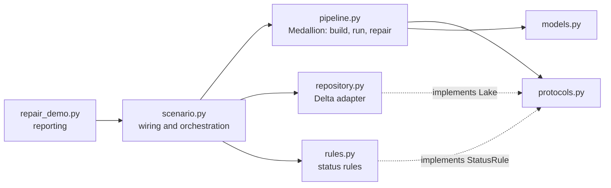

# Bronze to Silver Repair

**Repair a wrong Silver table from what Bronze already kept, without asking the source to send everything again, with an executable local Delta Lake example.**

Companion code for **Can You Rebuild Silver Without Reloading the Source?** A cleaning rule stored canceled orders as shipped. Fixing the rule and rerunning the job changes nothing, because an incremental run only reads new records. The project repairs Silver and Gold from a pinned Bronze version, and shows why the repair must be checked against a full rebuild.

The medallion pattern keeps raw inputs in **Bronze**, shared cleaned data in **Silver**, and purpose-built outputs in **Gold**. Here, Bronze is an append-only table of order changes, Silver holds one row per order, and Gold counts orders by date and status. A **change data feed (CDF)** records the row changes each Silver commit made.

The example uses synthetic order data, Python, pandas, and the open-source `deltalake` library (delta-rs). It runs locally without Spark or a Databricks workspace.

## Choose a route

| Route | Appropriate when | Local implementation |
| --- | --- | --- |
| **1. Rewind and replay** | The mistake is recent and every table is in one Databricks pipeline. | Not run. It is a Databricks pipeline feature (Beta at the time of writing). |
| **2. Full refresh** | The source still has every record and a full reload is affordable. | Not run as a pipeline operation. [`Medallion.full_rebuild`](src/pipeline.py) builds the same answer in memory and serves as the reference for the check. |
| **3. Scoped repair** | The mistake is older, the scope is narrow, or other readers depend on the tables. | [`Medallion.repair_silver`](src/pipeline.py) rebuilds the scope from a pinned Bronze version and replaces it in one commit; [`Medallion.repair_gold`](src/pipeline.py) recomputes the affected Gold dates. |

**Implementation scope:** Bronze, Silver, and Gold are real Delta tables on local disk. The "daily run" is a small Python incremental job whose checkpoint is an in-memory Bronze version number; it stands in for a pipeline refresh and is not a streaming table. Scoped writes use the `deltalake` library's predicate overwrite, which plays the role of Databricks `REPLACE WHERE`. Rewind and replay, a pipeline full refresh, streaming readers, `skipChangeCommits`, and multi-table transactions are not executed.

## Quick start

Requirements: **Python 3.10+**, `pip`, and Bash for the helper script. The first setup requires access to the Python package index. `make` is optional.

Run from the repository root:

```bash
./run_demo.sh
```

The script creates `.venv` if needed, installs `requirements.txt`, runs the tests, and prints the scenario results. `deltalake` is pinned to `1.6.6`; the other dependencies have minimum versions.

The demo deletes and recreates the repository's `lake/` directory on each run. Keep that directory reserved for generated demo data. The Python helper `run(lake)` likewise removes the directory passed to it.

To run the same steps manually:

```bash
python3 -m venv .venv
.venv/bin/python -m pip install -r requirements.txt
.venv/bin/python -m pytest
.venv/bin/python -m src.repair_demo
```

### Development commands

| Command | Action |
| --- | --- |
| `make` | Run lint, formatting checks, type checks, tests, and the demo. |
| `make setup` | Create `.venv` and install runtime and development tools. |
| `make test` | Run `pytest`. |
| `make lint` | Run `ruff check` and `ruff format --check`. |
| `make types` | Run `mypy src`. |
| `make demo` | Print the demo results. |
| `make clean` | Remove `.venv`, `lake/`, tool caches, and Python bytecode caches. |

The check and demo targets run dependency setup first. Once dependencies are installed, invoke tools directly with `.venv/bin/python -m pytest`, `.venv/bin/python -m ruff check .`, `.venv/bin/python -m ruff format --check .`, or `.venv/bin/python -m mypy src`.

## What the example demonstrates

Seven orders are loaded into Bronze in three commits, so Bronze ends at version **2**. Silver and Gold are built with a faulty rule that maps `CANCELLED` to `shipped`. Orders **2**, **5**, and **7** were cancelled. Order **7** is dated 1 November, but its cancellation arrives in the last batch. Order **8** arrives after the repair pins Bronze.

| Step | Expected result |
| --- | --- |
| Rerun the job with the corrected rule | It touches **0** orders, because only new records are read. The next run touches the one new order, 8. Orders 2, 5, and 7 stay `shipped`. |
| Repair the date range named in the incident (3 to 5 November) | Orders 2 and 5 become `canceled` in one commit. The CDF records **6 deletes and 6 inserts** for that commit, although only 2 orders changed. |
| Repeat the same repair; write a row outside the scope | Repeating changes nothing and Silver keeps **8 rows**. A row dated 1 December is refused. |
| Compare with a full rebuild, row by row | Order **7** differs. The date range missed it. |
| Repair by order keys, `order_id IN (2, 5, 7)` | Silver matches the full rebuild. Order 8 is kept once. |
| Repair Gold | Gold matches Silver only after its own repair. The emptied group, 1 November shipped, disappears. |
| Vacuum Silver with no retention | The pre-repair Silver version can no longer be read. The pinned Bronze version is still readable. |

The executable prints all outcomes. [`test_article_claims.py`](tests/test_article_claims.py) checks the reported values against real temporary Delta tables.

## Example output

The following successful `./run_demo.sh` run passed all **13 tests** and printed the results below. Test timing varies by machine; package installation and update notices are omitted.

```text
$ ./run_demo.sh
{out}
```

## Data and change semantics

Each Bronze row is one change from the source:

| Field | Meaning |
| --- | --- |
| `order_id` | Integer order identifier. |
| `seq` | The source's sequence number for that order. The highest one is the latest change. |
| `order_date` | Order date, as an ISO `YYYY-MM-DD` string. It does not change when the order is cancelled. |
| `raw_status` | `PLACED`, `SHIPPED`, or `CANCELLED`, as the source sent it. |

Silver keeps the latest change per order, by `seq`, with a status rule applied. Gold is `count(*)` by `order_date` and `status`.

A repair is described by a [`RepairRequest`](src/models.py): a reason, the pinned Bronze version, and a scope predicate over Silver columns. The scope is used twice: as a pandas filter on the rebuilt rows, and as the predicate of the Delta overwrite. Rows the write supplies must match that predicate, which is why a row outside the scope is refused.

The CDF summary compares each deleted row with its re-inserted replacement by `order_id`. A replace removes and re-adds every row in the scope, so the number of change rows describes the scope, not the number of real changes. This is what delta-rs recorded locally; another engine may record a selective overwrite differently.

See [`data/README.md`](data/README.md) for the seed fields and timeline.

## Architecture and SOLID assessment



The code broadly follows SOLID at the scale of a teaching project, with specific gaps:

| Principle | Assessment |
| --- | --- |
| **Single responsibility** | Status rules, persistence, building and repairing, orchestration, and reporting are separated into focused modules. |
| **Open/closed** | `Medallion` accepts any `StatusRule`; the faulty and corrected rules are swapped without changing the pipeline. |
| **Liskov substitution** | Both rules honour the same `StatusRule` contract, and the pure functions are tested without storage. There is no in-memory `Lake` fake yet, so substitution of the storage adapter is not tested. |
| **Interface segregation** | `StatusRule` has one method. `Lake` is wide: it bundles Bronze reads with Silver and Gold writes, and a repair that only reads Bronze still depends on all of them. |
| **Dependency inversion** | `Medallion` depends on protocols and never imports `deltalake`. `scenario.py`, however, also calls adapter-only methods directly (Bronze appends, the CDF summary, vacuum, and a time-travel read), so those steps are tied to the Delta adapter. |

The current structure is useful for the example. Before broadening it, split `Lake` into Bronze, Silver, and Gold interfaces, add an in-memory fake with shared adapter tests, and derive the affected Gold dates from the change feed instead of listing them in the scenario.

## Repository layout

```text
.
├── data/
│   ├── order_changes.json   # Three Bronze commits of synthetic order changes, plus one late arrival
│   └── README.md            # Seed fields and timeline
├── src/
│   ├── models.py            # RepairRequest, RowDiff, and FeedSummary value objects
│   ├── protocols.py         # StatusRule and Lake interfaces
│   ├── rules.py             # The faulty and the corrected status rule
│   ├── repository.py        # Local Delta persistence, scoped overwrite, CDF summary, vacuum
│   ├── pipeline.py          # Build Silver and Gold, daily run, scoped repair, full rebuild, row diff
│   ├── scenario.py          # Example orchestration and structured results
│   └── repair_demo.py       # Composition root and printed report
├── tests/
│   ├── conftest.py               # Temporary Delta scenario fixture
│   ├── test_article_claims.py    # End-to-end checks of the example results
│   └── test_pipeline.py          # Pure build, rule, and diff tests without storage
├── Makefile
├── pyproject.toml
├── requirements.txt
└── run_demo.sh
```

## Scope and limitations

- **Local demonstration:** all reads are materialized in pandas. Eight synthetic orders illustrate correctness, not throughput or cost.
- **Stand-in incremental job:** `daily_run` finds new changes by comparing two Bronze versions and keeps its checkpoint in memory. It is not a streaming checkpoint and is not crash-safe.
- **Scope predicates:** `_to_pandas` translates only the simple `AND` and `IN` predicates used here into a pandas query. Other SQL needs a real parser or a structured scope.
- **Gold repair dates:** the affected dates are listed in the scenario. A production repair should derive them from the old and new rows of the Silver change feed.
- **No cross-table atomicity:** Silver and Gold are repaired in separate commits. A reader can see Silver repaired and Gold not yet repaired.
- **Rollback window:** the vacuum step deliberately disables retention to show the limit. Real tables keep their retention period, and a long repair should take a deep clone or raise retention first.
- **Engine scope:** the change shapes come from local delta-rs writes. They do not establish how a Databricks pipeline or another engine records a selective overwrite.

## Data and license

All example data is synthetic. No `LICENSE` file is included, and the repository does not currently declare a reuse license.
